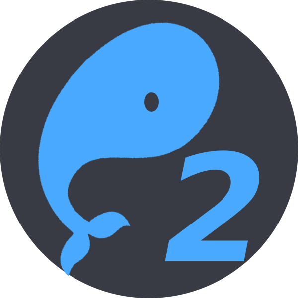

<div align="center">
    
    <br/>
    <br/>
    <a href="https://github.com/pwnpad/pwnpad/blob/master/LICENSE"></a>
    
    <h1>PwnPad Lima</h1>
    <p>A fully virtualised environment</p>
</div>

## Requirements

If you are building this yourself, you will need the following tools installed:

### MacOS

- `lima` (special version required)
- `ansible` (not required if not building)
- `qemu` (not required if not building)

To get the full experience, you will need a special version of [lima](https://github.com/pwnpad/lima/releases) that supports USB passthrough.
To install, download the latest Darwin ARM64 build and extract it to `/usr/local/`:

```bash
tar -xzvf lima-*-Darwin-arm64.tar.gz -C /usr/local/
```

You may skip this step if you are using the pre-built VM.

```bash
brew install ansible qemu
```

## Building

To build the VM yourself:

```bash
./build_vm.sh
```

If you would like to export the VM to a qcow2 file:

```bash
./create_qcow2.sh
```

The file will be created in `~/.lima/pwnpad-builder/pwnpad-arm64.qcow2`

### GitHub Actions

The [Build images](.github/workflows/build.yml) workflow builds both `x86_64` and `arm64` images. It runs when `dev` or a version tag is pushed, or manually from the Actions tab.

The images are uploaded as artifacts, since release files are limited to 2GB. You need to be logged in to GitHub to download them, and they expire after 90 days. Download them from the run's page, or with `gh`:

```bash
ID=$(gh api "repos/pwnpad/pwnpad/actions/runs/<run id>/artifacts" --jq '.artifacts[] | select(.name == "pwnpad-arm64.qcow2").id')
gh api "repos/pwnpad/pwnpad/actions/artifacts/${ID}/zip" > pwnpad-arm64.qcow2
```

The file is not zipped, so `gh run download` will not work. The SHA256 is in the run's summary.

## Usage

Create the new VM using the following command:

```bash
limactl create --yes https://raw.githubusercontent.com/pwnpad/pwnpad-lima/refs/heads/master/lima/pwnpad.yml
```
